# Cloud Armor demo — edge L3/L4 + WAF → Private Service Connect → GKE

A runnable demonstration of Google Cloud Armor protecting a GKE workload, built
entirely with `gcloud` and `kubectl`.

Traffic enters a **global external Application Load Balancer** where Cloud Armor
enforces IP denylists/allowlists, geo blocking and the OWASP preconfigured WAF
rules for SQL injection and cross-site scripting. Allowed traffic crosses into a
second VPC over **Private Service Connect**, reaches a **regional internal
Application Load Balancer**, and lands on a **GKE Autopilot** cluster running a
hello-world app. A second, regional Cloud Armor policy applies rate limiting at
that inner tier.

The GKE pods have no public address and no route from the internet. The edge load
balancer is the only way in.



<sub>12-second loop showing all three cases. Not animating in your viewer?
Open <a href="docs/architecture-preview.html">docs/architecture-preview.html</a> locally.
Also available as <a href="docs/architecture.gif">an animated GIF</a> and a
<a href="docs/architecture-still.png">static PNG</a>, for slides and anywhere SVG
isn't supported.</sub>

---

## Architecture

The same picture as text, with the rule priorities spelled out:

```
                        Attacker / you
                              │
                              ▼  global anycast IP, HTTP :80
        ┌─────────────────────────────────────────────────────┐
        │  Google edge POP — nearest to the client            │
        │  ┌───────────────────────────────────────────────┐  │
        │  │ POLICY 1   armor-edge   (global)              │  │
        │  │   attached with gcloud                        │  │
        │  │    500  allow     IP allowlist   (toggle)     │  │
        │  │   1000  deny      IP/CIDR denylist            │  │
        │  │   1100  deny      geo region_code             │  │
        │  │   2000  deny      WAF sqli-v422-stable        │  │
        │  │   2100  deny      WAF xss-v422-stable         │  │
        │  │   default allow                               │  │
        │  └───────────────────────────────────────────────┘  │
        │        global external ALB  (EXTERNAL_MANAGED)      │
        └───────────────────────────┬─────────────────────────┘
                                    │  403 stops here
   ═══ armor-consumer-vpc ══════════╪═══════════════════════════
                                    │  PSC NEG (/32 in consumer-subnet)
                                    ╎
                              ─ ─ ─ PSC ─ ─ ─   service attachment
                                    ╎           (NAT subnet SNATs here)
   ═══ armor-producer-vpc ══════════╪═══════════════════════════
                                    ▼
        ┌─────────────────────────────────────────────────────┐
        │  Regional internal ALB  (INTERNAL_MANAGED)          │
        │  built by GKE Gateway  gke-l7-rilb                  │
        │  ┌───────────────────────────────────────────────┐  │
        │  │ POLICY 2   armor-app   (regional)             │  │
        │  │   attached with GCPBackendPolicy              │  │
        │  │   3000  throttle        20 req/min            │  │
        │  │   3100  rate-based-ban  /login                │  │
        │  │   (WAF not supported at this tier)            │  │
        │  └───────────────────────────────────────────────┘  │
        └───────────────────────────┬─────────────────────────┘
                                    ▼  zonal NEGs
                   GKE Autopilot · europe-west1
                   Service hello-world (ClusterIP :8080)
                   Pods: whereami — echoes what arrived
```

---

## Why the WAF is at the edge and not in front of GKE

This is the one design point worth understanding before you present the demo,
because the obvious arrangement does not work.

**A regional internal Application Load Balancer cannot enforce WAF rules.** Cloud
Armor's capability matrix for that load balancer type supports only allow, deny,
throttle and rate-based ban, matched on client IP or JA3 fingerprint. WAF rules,
managed rules, body filtering, **geography and ASN** are all unsupported
([security policy overview][sp]).

A `GCPBackendPolicy` *will* attach a WAF-bearing policy to the GKE Service. It
resolves to `backendServices.setSecurityPolicy` on the backend service the Gateway
built, the manifest applies cleanly, and `kubectl describe` reports
`Attached: True`. The SQLi and XSS rules then never fire. That is the worst
possible outcome — it looks protected and is not.

`armor.sh` therefore **refuses** to add a WAF, managed-rules, body-filtering, geo
or ASN rule to the regional policy, and fails with an explanation rather than
letting you configure a silent gap.

A second effect compounds this: Private Service Connect SNATs traffic through the
NAT subnet, so the inner tier sees PSC addresses rather than real client IPs.
IP-based rules there would be meaningless too. Rate limiting is what that tier can
enforce honestly, so that is what it does — keyed on `XFF-IP` to recover the
original client from the `X-Forwarded-For` header the edge load balancer sets.

[sp]: https://cloud.google.com/armor/docs/security-policy-overview

---

## Prerequisites

- A GCP project with billing enabled
- `gcloud` authenticated: `gcloud auth login`
- `kubectl` (`gcloud components install kubectl`)
- `curl`; optionally `jq` for nicer log output

Cloud Armor **Standard** covers everything here. Every project with an external
Application Load Balancer is enrolled automatically — there is no subscription to
buy. Adaptive Protection, Threat Intelligence and Address Groups would need
Enterprise and are not used.

## Quick start

```bash
cp config.env.example config.env
$EDITOR config.env          # set PROJECT_ID; the rest has working defaults

./provision-all.sh          # ~25-30 minutes
```

Then:

```bash
./armor.sh status           # both policies and where each is attached
./attack.sh baseline        # legitimate traffic passes
./attack.sh sqli xss        # attacks are blocked at the edge
./logs.sh                   # what Cloud Armor recorded, signature by signature
```

For a live walkthrough, follow [docs/DEMO_SCRIPT.md](docs/DEMO_SCRIPT.md).

When you are finished:

```bash
./teardown.sh
```

---

## Scripts

Numbered scripts run in order; the dependencies between them are real. Each is
idempotent, so re-running after a failure is safe.

| Script | What it does |
|---|---|
| `00-network.sh` | Both VPCs, all subnets (including the `REGIONAL_MANAGED_PROXY` and `PRIVATE_SERVICE_CONNECT` ones), firewall rules, the reserved edge IP |
| `01-gke.sh` | GKE Autopilot cluster in the producer VPC; verifies the `gke-l7-rilb` GatewayClass |
| `02-app.sh` | The hello-world app, the internal Gateway, and the `GCPBackendPolicy` attachment |
| `03-psc-publish.sh` | Finds the internal ALB's forwarding rule and publishes it as a service attachment |
| `04-edge.sh` | PSC NEG, global backend service, URL map, proxy, forwarding rule; attaches the edge policy |
| `05-geo-probe.sh` | **Optional.** A throwaway VM in a second country, used to validate geo blocking — see below |
| `provision-all.sh` | Runs 00–04 in order (not 05, which only `attack.sh geo` needs) |
| `armor.sh` | Creates and toggles every rule — the demo control panel |
| `attack.sh` | Fires labelled payloads and tabulates pass/block |
| `logs.sh` | Reads Cloud Armor's decisions out of Cloud Logging |
| `teardown.sh` | Deletes everything, in an order the dependencies allow |

### `armor.sh`

```
create                 Create both policies and the baseline rules
status                 Show every rule and where each policy is attached
reset                  Remove all demo rules; allow everything

waf on|off             SQLi + XSS preconfigured WAF rules      (edge)
waf preview            Log what the WAF would block, without enforcing
denylist on|off        Deny the CIDRs in DENY_CIDRS            (edge)
deny-me                Add your own public IP to the denylist  (edge)
undeny-me              Remove it again
allowlist on|off       Flip the default rule to deny           (edge)
geo [CC|off]           Deny a country by region code           (edge)
ratelimit on|off       Throttle + rate-based ban               (app tier)
```

### `attack.sh`

```
baseline    benign traffic that should always pass
sqli        SQL injection payloads           (expects 403)
xss         cross-site scripting payloads    (expects 403)
sqli-open   the same payloads, expecting 200 — for use with the WAF off
xss-open    likewise
denylist    full lifecycle: before -> deny-me -> confirm -> undeny-me -> after
geo         full lifecycle, from two countries (needs 05-geo-probe.sh)
flood       burst traffic to trip the app-tier rate limit
ban         proves the ban OUTLIVES the traffic, unlike a plain throttle
all         default. baseline + sqli + xss only — see note below
```

**`all` does not include `flood`, `denylist`, `geo` or `ban`.** Each of those
scenarios changes the policy itself — denylisting your IP, flipping a geo rule,
tripping a rate limit — and takes one to several minutes to run because of
Cloud Armor's propagation delay (see below). Running them automatically would
make every following scenario fail for the wrong reason. Run them individually
when you want to exercise that part of the demo.

**`denylist` and `geo` are self-orchestrating.** They don't assume you've
already set up the right state with `armor.sh` — each one changes the policy,
waits for propagation, checks the effect, checks the *Cloud Logging* evidence
names the expected rule (not just "got a 403" — the WAF, geo rule and denylist
all return 403, so confirming which priority fired is what actually proves the
right rule did it), then reverts. `geo` runs that twice, once blocking each
country, and checks the results swap — which is the only way to prove a geo
rule discriminates by country rather than just blocking everyone.

### `05-geo-probe.sh` — testing geo blocking from a second country

A geo rule can't be meaningfully validated from one origin: blocking your own
country and seeing a 403 only proves the rule fires, not that it's selective.
You need a request from elsewhere that still succeeds.

This script creates a single `e2-micro` VM in `us-central1`, in its own VPC,
reachable only via `gcloud compute ssh --tunnel-through-iap` (no public SSH).
It costs about a cent an hour and `./teardown.sh` removes it.

Public proxy services were considered and rejected for this — free proxies are
unreliable, often short-lived, and frequently operated by parties who can read
or modify the traffic passing through them. A VM you own and control is the
more trustworthy choice, especially in a demo about security.

```bash
./05-geo-probe.sh     # one-time, ~1 minute
./attack.sh geo       # uses it automatically; skips with a clear message if absent
```

---

## The rules

### Policy 1 — `armor-edge` (global, on the edge load balancer)

| Priority | Rule | Action |
|---|---|---|
| 500 | IP allowlist — allowlist mode only | `allow` |
| 1000 | IP/CIDR denylist | `deny-403` |
| 1100 | Geo block by `origin.region_code` | `deny-403` |
| 2000 | `evaluatePreconfiguredWaf('sqli-v422-stable', {'sensitivity': 1})` | `deny-403` |
| 2100 | `evaluatePreconfiguredWaf('xss-v422-stable', {'sensitivity': 1})` | `deny-403` |
| 2147483647 | default | `allow`, or `deny-403` in allowlist mode |

### Policy 2 — `armor-app` (regional, on the GKE internal ALB)

| Priority | Rule | Action |
|---|---|---|
| 3000 | Throttle 20 requests / 60s per client | `throttle` → `deny-429` |
| 3100 | Rate-based ban on `/login` | `rate-based-ban` → `deny-429` |

**Rule set version.** The current preconfigured sets are `sqli-v422-stable` and
`xss-v422-stable` (OWASP CRS 4.22). Material you will find online still shows
`v33`. `armor.sh create` verifies the configured version exists and lists the
alternatives if not.

**Sensitivity.** Level 1 is the lowest false-positive setting and still catches
every payload in `attack.sh`. Raise `WAF_SENSITIVITY` in `config.env` to 2–4 for
broader coverage and more false positives.

---

## Things worth knowing

**Rule priority order is not cosmetic — a general rule above a specific one
makes the specific one unreachable.** The rate-limit rules are the example that
actually caught this in testing: the throttle rule matches `--src-ip-ranges="*"`
(every request). An earlier version put it *above* the `/login` rate-based-ban
rule, so every request matched the throttle rule first and the ban rule never
fired — confirmed by checking the logs: 195 matches, all on the throttle rule,
zero bans, despite `armor.sh status` showing both rules configured and no error
anywhere. Fixed by reordering so the specific rule sits above the general one.
The general lesson: in any first-match-wins policy engine, order from narrowest
match to broadest.

**The internal load balancer must have global access enabled.** This is not
optional and not obvious. A *global* external Application Load Balancer consuming a
Private Service Connect NEG rejects the backend unless the *producer* load balancer
has `AllowGlobalAccess` set:

```
Global L7 Private Service Connect consumers require the Private Service Connect
producer load balancer to have AllowGlobalAccess enabled.
```

`k8s/gateway.yaml` sets it with a `GCPGatewayPolicy`, applied at the same time as the
Gateway. Order matters: enabling global access on an *existing* internal Gateway
recreates its forwarding rule, and the service attachment points at that rule — so
turning it on after the fact means deleting the PSC NEG and the service attachment,
waiting for the rule to settle, then re-running `03-psc-publish.sh` and `04-edge.sh`.
The forwarding rule also reports `is not ready` for a minute or so afterwards.

**Rule changes take minutes, not seconds.** Measured here, a toggle took between
15 seconds and over 3 minutes to be live at the edge, and the SQLi and XSS rules
did not propagate together. Every `armor.sh` toggle blocks until a canary request
proves the change has landed, so `./armor.sh waf on` can sit for several minutes
before returning. That is deliberate — returning early would mean `attack.sh`
testing a stale policy and appearing to show a broken WAF.

**Rate limiting is keyed on `xff-ip`, not `ip`.** PSC SNATs traffic, so the
internal load balancer sees Google proxy addresses rather than real clients.
`xff-ip` recovers the originating IP from the `X-Forwarded-For` header the edge
load balancer sets. You can see both in `./logs.sh --app`: `client` is the proxy,
`key=` is the real client.

**Rate limit thresholds are per backend service**, not global. The observed
numbers will not match a naive per-client calculation.

**Log entries lag.** Load balancer logs reach Cloud Logging up to a minute after
the request. An empty `./logs.sh` immediately after `./attack.sh` is expected.

**Verbose logging is on.** `armor.sh create` sets `--log-level=VERBOSE` on the
edge policy, which records which request field and value tripped a WAF rule, not
just that one matched. It also means snippets of request data land in your logs —
fine for a demo, worth turning off for anything real.

**Allowlist mode can lock you out.** `armor.sh allowlist on` flips the default
rule to deny. It always adds your detected public IP to the allow rule first, and
refuses to run if it cannot detect one.

**Two attachment mechanisms, deliberately.** The edge load balancer is hand-built,
so its policy is attached with `gcloud compute backend-services update
--security-policy`. The internal one is Gateway-managed, so its policy is attached
with `GCPBackendPolicy` — setting it with gcloud there would be overwritten by the
controller on its next sync.

**The demo app is not exploitable.** It is Google's stock `whereami` sample, which
echoes the request it received. There is no database and no injection sink. The
echo exists so you can see a payload arrive at the pod with the WAF off.

---

## Cost

Two load balancers, two Cloud Armor policies, a PSC attachment and an Autopilot
cluster. Cloud Armor Standard is roughly $5 per policy per month plus $1 per rule
per month plus $0.75 per million requests; the global forwarding rule is about $18
a month; Autopilot adds cluster management and pod resources on top.

This is not free to leave running. `./teardown.sh` removes everything.

---

## Reference

- [Cloud Armor security policy overview](https://cloud.google.com/armor/docs/security-policy-overview) — the capability matrix per load balancer type
- [Configure preconfigured WAF rules](https://cloud.google.com/armor/docs/configure-waf)
- [Cloud Armor request logging](https://cloud.google.com/armor/docs/request-logging)
- [Private Service Connect backends](https://cloud.google.com/vpc/docs/private-service-connect-backends)
- [Publish services with Private Service Connect](https://cloud.google.com/vpc/docs/configure-private-service-connect-producer)
- [Configure GKE Gateway resources](https://cloud.google.com/kubernetes-engine/docs/how-to/configure-gateway-resources)
